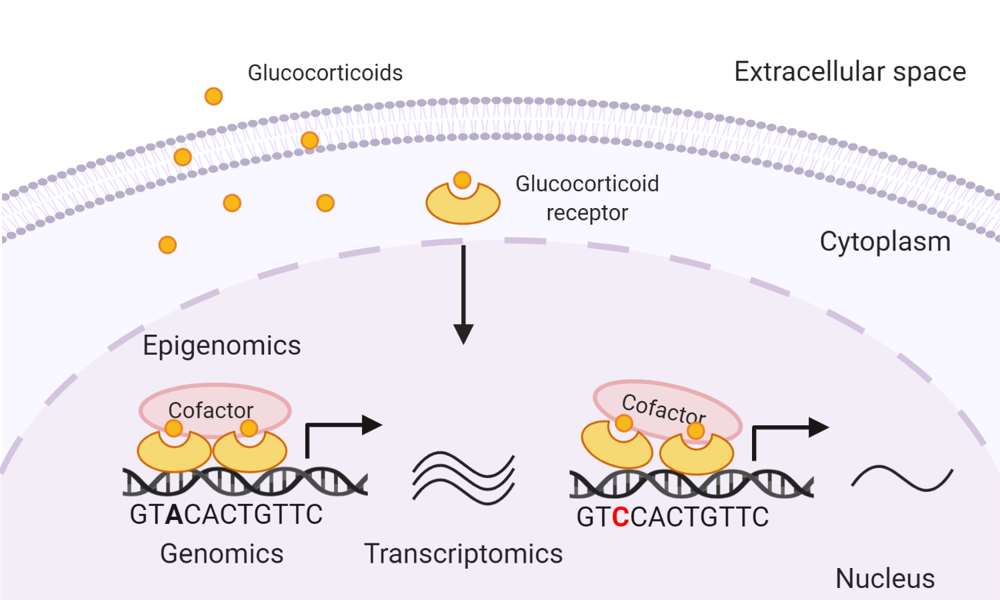
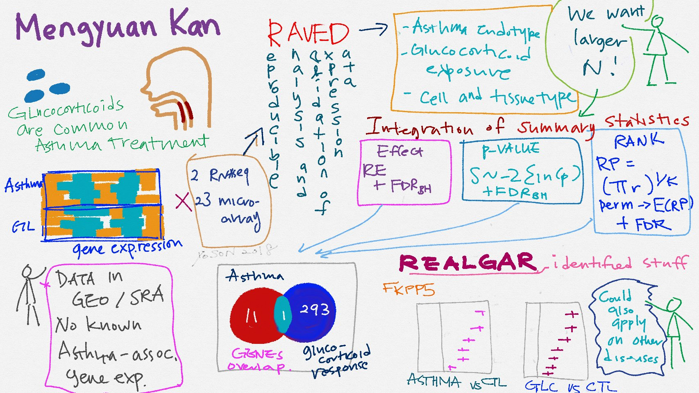

### Research Summary

- [Integrative Multiomics Analysis Reveals Novel Disease Mechanisms](#multiomics)
- [Leveraging Public Omics Datasets to Generate Novel Hypotheses](#publicomics)
- [AI-driven Modeling for Disease Subtype and Progression](#ai)

---

### Integrative Multiomics Analysis Reveals Novel Disease Mechanisms

Omics approaches have advanced our [understanding](https://pubmed.ncbi.nlm.nih.gov/28774304/) of complex respiratory diseases. However, our ability to generate omics data far exceeds our ability to interpret and validate findings that are biologically informed. Most omics studies focus on biological information from single modalities. Integrative analysis of multiomics data provides insights into disease mechanisms beyond those from single-layered omics data.

We used an asthma-related phenotype, glucocorticoid response, as a study model. [Glucocorticoids](https://pubmed.ncbi.nlm.nih.gov/32910934/), commonly used drugs for the treatment of asthma, are known to exert anti-inflammatory effects via binding to glucocorticoid receptors (GRs), a class of transcription factors, and modulating gene transcription. Some asthma patients respond pooly to glucocorticoids, in part due to genetic differences. Yet genome-wide association studies (GWAS) of glucocorticoid response did not find reproducible genetic associations that reach genome-wide significance.

We first integrated transcriptomic data and [identified](https://pubmed.ncbi.nlm.nih.gov/30694689/) airway smooth muscle-specific gene expression signature of glucocorticoid response. To leverage genetic variants with nominal associations, we further developed [multiomics integrative scores](https://pubmed.ncbi.nlm.nih.gov/34971648/) to rank these variants based on their functional annotations inferred from transcripotmic, ChIP-Seq, DNA motif, and eQTL data. Using this framework, we identified variants near the gene *BIRC3* as a novel genetic locus that might influence patients' response to glucocorticoids via modulation of GR signaling in airway cells. This integrative framework can be extended to prioritize nominal genetic associations for other complex phenotypes for further mechanistic studies.

---

### Leveraging Public Omics Datasets to Generate Novel Hypotheses

With the advent of high-throughput omics technologies, the volume of publicly available omics data has increased ever since. These data include experiments that compared disease versus healthy individuals, as well as cells exposed to drugs versus vehicle control. Leveraging existing datasets offers experimental researchers a cost-effective avenue to test their novel hypotheses on disease mechanisms. Although these datasets are valuable, in their raw form, they are not readily usable by researchers to generate hypotheses and design validation experiments.

To facilitate the reproducible analysis of publicly available omics data, we developed pipelines [RAVED](https://github.com/HimesGroup/raved) for transcriptomic data analysis and [brocade](https://github.com/HimesGroup/brocade) for ChIP-Seq data analysis, and an web application [REALGAR](https://github.com/HimesGroup/realgar) that integrates analysis-ready omics data and allows end-users to visualize integrated results on-the-fly.

These open-source tools enabled the identification of tissue-specific [differentially expressed genes](https://pubmed.ncbi.nlm.nih.gov/30815178/) and [differential transcription factor binding sites](https://pubmed.ncbi.nlm.nih.gov/32308830/) related to asthma and drug response. In addition, they facilitated the 
prioritization of [asthma-associated variants](https://pubmed.ncbi.nlm.nih.gov/35863045/) that may contribute to asthma susceptibility through their influence on glucocorticoid receptor-mediated glucocorticoid response. Here is a nice illustration of my work by [Yoson](https://github.com/ypar) when I presented *RAVED* and *REALGAR* in IBI retreat.

---

### AI-driven Modeling for Disease Subtype and Progression

In collaboration with [Dr. Nuala Meyer](https://www.med.upenn.edu/apps/faculty/index.php/g275/p8202234) and colleagues, I integrated transcriptomic and EHR-derived clinical data from critically ill patients with sepsis and [identified](https://pubmed.ncbi.nlm.nih.gov/41738283/) molecular signatures associated with mortality risk and cytokine levels through multilevel analyses at the gene, pathway and network levels. 

Building upon these findings, my ongoing research applies advanced AI-driven modeling approaches to understand the genetic and molecular basis underlying why some patients progress toward severe outcomes while others do not. Previously, we applied the AI-driven modeling approach Subtype and Stage Inference (SuStaIn) to identify amyloid imaging–based subtypes of patients with Alzheimer's disease, as well as the genetic basis for these subtypes. I am now extending this approach to sepsis to infer latent molecular subtypes and progression stages associated with disease severity and mortality. By integrating transcriptomic, genomic, and clinical data, this work aims to determine how dynamic gene expression programs and inherited genetic variation shape disease trajectories, outcomes, and patient heterogeneity in sepsis. Ultimately, these studies seek to identify mechanistic drivers, predictive biomarkers, and potential therapeutic targets for precision management of sepsis.

---

In addition to the work described above, I collaborate closely with molecular biologists to analyze and interpret multiomics data, and have contributed to significant scientific [discoveries](https://penntoday.upenn.edu/news/self-eating-stem-cell-process-may-be-key-new-regenerative-therapies) across diverse disease areas.